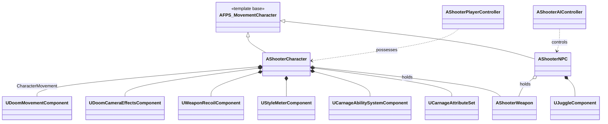

# Architecture

This document describes how the C++ code in `Source/FPS_Movement/` is organized and how the main systems interact. For a feature overview, see [README.md](README.md). For the Gameplay Ability System layer in detail, see [Docs/Systems/GAS.md](Docs/Systems/GAS.md).

Gameplay logic is written in C++. Blueprints are used for asset references, tuning values, and widget layout.

## Source Layout

```
Source/FPS_Movement/
├── Core/          Game framework classes and gameplay glue
│   ├── AI/        NPC character, AI controller, StateTree utilities, spawner, juggle component
│   ├── UI/        HUD widget base classes
│   └── Weapons/   Weapon, projectile, pickup, damage pipeline, hit feedback interface
├── Movement/      Custom CharacterMovementComponent (DoomMovementComponent)
├── Camera/        Movement-driven camera effects and camera modifier
├── Weapons/       Recoil spring, sway, and recoil profile types
├── Carnage/       Gameplay Ability System layer (player health, armor, damage tags)
└── Template/      Base classes inherited from the Unreal first-person template
```

### Module Map

| Folder | Contents | Notes |
| :--- | :--- | :--- |
| `Core/` | `AShooterCharacter`, `AShooterPlayerController`, `AShooterGameMode`, `UStyleMeterComponent` | The game itself. |
| `Core/AI/` | `AShooterNPC`, `AShooterAIController`, `UJuggleComponent`, `UEnvQueryContext_Target`, `AShooterNPCSpawner`, `ShooterStateTreeUtility` | StateTree-driven enemy AI. |
| `Core/Weapons/` | `AShooterWeapon`, `AShooterProjectile`, `AShooterPickup`, `ShooterDamageUtils`, `IShooterWeaponHolder`, `IShooterHitFeedbackReceiver` | Hitscan and projectile fire modes share one damage path. |
| `Core/UI/` | `UShooterUI`, `UShooterBulletCounterUI` | Widget base classes; layouts are built in UMG. |
| `Movement/` | `UDoomMovementComponent` | Custom movement, including sprint, slide, dash, wall run, mantle, and bunny hop. |
| `Camera/` | `UDoomCameraEffectsComponent`, `UDoomCameraModifier` | FOV, tilt, bob, and dip effects driven by movement state. |
| `Weapons/` | `UWeaponRecoilComponent`, `FWeaponRecoilParams` | Aim recoil, procedural weapon kick, and sway. |
| `Carnage/` | `UCarnageAbilitySystemComponent`, `UCarnageAttributeSet`, native gameplay tags, `UGE_InstantDamage` | Player vitals on GAS. |
| `Template/` | `AFPS_MovementCharacter` and template base classes | See the note below. |

### Template Base Classes

`Template/` holds classes derived from the Unreal first-person template. The project is moving away from them:

- `AFPS_MovementCharacter` is still the base class of `AShooterCharacter` and `AShooterNPC`.
- The template player controller, game mode, and camera manager are being removed. `AShooterPlayerController` and `AShooterGameMode` already derive directly from `APlayerController` and `AGameModeBase`, and are the classes used at runtime.

## Class Relationships



## Frame Flow

```
Enhanced Input (mapping contexts loaded by AShooterPlayerController)
  -> AShooterCharacter (fire, jump, slide, dash, reload, swap)
      -> UDoomMovementComponent            movement verbs, coyote time, jump buffer
      -> AShooterWeapon::StartFiring()
          -> FireShot(): projectile spawn or hitscan trace
              -> ShooterDamage::ApplyHit()
                  -> NPC: CurrentHP  /  player: GAS (armor, then health)
                  -> headshot and kill resolution
                  -> IShooterHitFeedbackReceiver on the shooter
                      -> hit confirmed event, hit sounds, kill hitstop
          -> AddWeaponRecoil -> UWeaponRecoilComponent
      -> UDoomCameraEffectsComponent reads movement state -> FOV, tilt, bob
```

## Movement

`UDoomMovementComponent` replaces the default `CharacterMovementComponent` through the constructor of `AShooterCharacter`.

- **Sprint and slide.** Momentum-based slide with entry speed scaling, slope acceleration, sprint-slide entry boost, and an anti-spam cooldown.
- **Dash.** Charge-based air dash with recharge.
- **Wall run.** Custom movement mode with momentum preservation, wall jumps, and a reattach cooldown.
- **Mantle.** Ledge climb.
- **Jumps.** Double jump with air control, coyote time, jump buffering, and bunny hop momentum chaining.
- **Events.** Broadcasts `OnMovementAction` for each traversal. The style system and other listeners subscribe to this delegate.
- **External speed.** `SetExternalSpeedScale` lets other systems adjust speed without a direct dependency on them.
- **Profiling.** Movement tick and wall-run sections are instrumented with `STAT_DoomMovementTick` and `STAT_DoomWallRun`.

## Style System (Carnage Meter)

`UStyleMeterComponent` converts player actions into a rank from D to SSS.

- Consumes `OnMovementAction`, hit confirmations, and damage events.
- Applies a variety multiplier. Repeating the same move earns less, and using different moves earns more.
- Decays over time, faster at higher ranks. Taking damage reduces the meter.
- When gameplay effects are enabled, the rank grants a speed bonus through `SetExternalSpeedScale` and an outgoing damage bonus. The damage bonus is read through `IShooterWeaponHolder::GetOutgoingDamageMultiplier` at the damage chokepoint.
- Exposes `OnRankChanged` and `OnMeterChanged` delegates for UMG.

## Combat and Damage

All weapon damage goes through `ShooterDamage::ApplyHit`, in `Core/Weapons/ShooterDamageUtils`. Projectiles and hitscan shots both use this path.

- **Headshots.** Resolved by bone or by capsule height.
- **Kills.** Detected through the `Dead` actor tag.
- **Feedback.** Instigators receive hit feedback through `IShooterHitFeedbackReceiver`.

Damage is applied differently to the two character types:

- **Player (`AShooterCharacter`).** Damage is applied through the Gameplay Ability System. Armor absorbs a fraction of incoming damage before health.
- **NPC (`AShooterNPC`).** Damage reduces a plain `CurrentHP` float in `TakeDamage`. This is a simpler path than the player's GAS pipeline.

## Gameplay Ability System

`AShooterCharacter` owns a `UCarnageAbilitySystemComponent` and a `UCarnageAttributeSet`. The attribute set tracks health, armor, and a reserved shield. Movement state is mirrored to native gameplay tags each tick. Full details are in [Docs/Systems/GAS.md](Docs/Systems/GAS.md).

## Camera and Recoil

- `UDoomCameraEffectsComponent` runs a state machine for FOV (sprint, slide, dash, aim down sights), strafe and wall-run tilt, head bob, landing dip, and slide dip. It reads aim state through a delegate, so it does not depend on the character class. It applies its values through a runtime-created `UDoomCameraModifier`.
- `UWeaponRecoilComponent` runs an aim-recoil spring with recovery and player compensation, plus procedural kick on the first-person mesh and look and movement sway. It writes control rotation directly. Recoil profiles are defined per weapon in `FWeaponRecoilParams`.

## AI

- `AShooterNPC` implements the weapon holder interface and carries a `UJuggleComponent`. Juggle combat lets the player launch enemies, keep them airborne, and slam them down.
- `AShooterAIController` runs a `UStateTreeAIComponent`. `ShooterStateTreeUtility` provides the custom StateTree tasks and helpers.
- `UEnvQueryContext_Target` supplies the target context for Environment Query System queries.
- `AShooterNPCSpawner` spawns NPCs in the level.

## Limitations

- **Single-player only.** `UDoomMovementComponent` is not network-prediction-safe. Replication and client prediction would need to be designed before multiplayer is supported.
- **NPC damage path.** NPCs use the plain `CurrentHP` path rather than the GAS pipeline. Unifying them onto the Ability System is planned. See [Docs/ROADMAP.md](Docs/ROADMAP.md).
