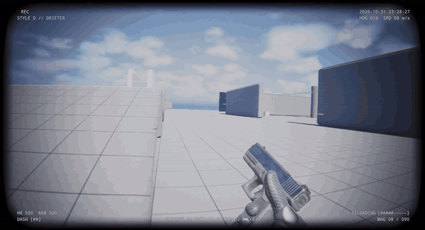

# Project Carnage

A first-person movement shooter built in C++ with Unreal Engine 5.7. Momentum-based movement chains into aggressive combat, and a style rank system rewards varied play.

<!-- TODO: Record a short gameplay GIF (movement chain plus juggle combat, about 10 seconds) and save it to Docs/media/gameplay.gif. -->

## Features

**Movement**
- Momentum slide with slope acceleration and sprint-slide boost
- Air dash with charges and recharge
- Wall run with momentum preservation and wall jumps
- Mantle onto ledges
- Double jump with air control, coyote time, and jump buffering
- Bunny hop momentum chaining

**Combat**
- Hitscan and projectile fire modes
- Spring-based recoil with recovery, procedural weapon kick, and sway
- Reload system with reserve ammo, fire lockout, and auto reload on empty
- Headshots, hit confirmation, and kill hitstop
- Procedural aim down sights: one critically damped spring drives sight alignment, world and viewmodel FOV, look sensitivity, sway, recoil, and move speed, so every effect stays in sync and reversing mid-transition never pops
- Sight alignment computed from the weapon's sight frame, blended in sight space so the gun glides straight to the eye
- Three recoil channels: aim recoil with recovery, spring-back view punch, and viewmodel kick
- Viewmodel look lag, figure-8 walk bob, landing inertia, and sprint and slide poses
- Procedural gunfire VFX with no Niagara assets: pooled muzzle flash, light pulse, tracers from the visible muzzle, impact sparks, shells, and bullet-hole decals
- Hitscan traced from the camera, with first-person-rendering-correct tracer origins

**Style and Juggle**
- Carnage Meter: a D to SSS rank that rewards varied, aggressive play
- Rank buffs: higher ranks grant more movement speed and more damage
- Juggle combat: slide into enemies to launch them, keep them airborne, slam them down, and bounce them back up

**AI and Feedback**
- Enemy AI driven by StateTree
- Camera effects tied to movement: FOV changes, strafe and wall-run tilt, head bob, landing dip

## What I Built vs. Engine Template

The project starts from the Unreal first-person template. This table shows which parts are original work.

| Area | Built for this project | Starting point from Unreal |
| :--- | :--- | :--- |
| Character movement | `UDoomMovementComponent`: custom CharacterMovementComponent with slide, dash, wall run, mantle, and jump extensions | Default `CharacterMovementComponent` (replaced) |
| Style system | `UStyleMeterComponent`: Carnage Meter with variety scoring and rank effects | None |
| Combat | Juggle system, shared damage pipeline, headshot and kill resolution, hit feedback | Variant_Shooter sample projectiles and hit handling (extended) |
| Weapons | Procedural ADS, sight alignment, recoil, sway, and bob (`UWeaponRecoilComponent`); camera-traced hitscan and projectile fire modes | Variant_Shooter sample weapon actor (extended) |
| VFX | `UCarnageWeaponFXSubsystem`: pooled instanced-mesh muzzle flash, tracers, sparks, shells, and decals, tuned in Project Settings; materials generated by `Tools/Python/make_fx_materials.py` | None (template Niagara burst replaced) |
| HUD | `UShooterHUDWidget`: dynamic crosshair, hitmarkers, damage direction, ammo, health and armor, dash pips, and style rank, drawn entirely in C++ | Template UMG bullet counter and score widget (retired) |
| Health | Gameplay Ability System layer (`UCarnageAttributeSet`, armor and health, native tags) | None |
| Camera | `UDoomCameraEffectsComponent` and `UDoomCameraModifier` | Default first-person camera |
| AI | StateTree tasks, EQS target context, juggle-aware NPC | Variant_Shooter sample AI controller and NPC (extended) |
| Game framework | `AShooterPlayerController`, `AShooterGameMode` | First-person template base classes and Variant_Shooter sample |

## Tech Highlights

- **Custom CharacterMovementComponent.** `UDoomMovementComponent` owns movement verbs and exposes `OnMovementAction` so other systems can react to traversal. An external speed scale lets systems boost movement without a direct dependency.
- **GAS attribute set.** `UCarnageAttributeSet` manages health, armor, and an incoming damage meta-attribute. Damage is applied through a SetByCaller gameplay effect. Movement state is mirrored to native gameplay tags.
- **StateTree AI.** Enemy behavior runs in StateTree with custom tasks and an Environment Query System context.
- **Camera modifier.** Movement state drives a runtime camera modifier for FOV, tilt, and bob, decoupled from the character class.

Architecture details are in [ARCHITECTURE.md](ARCHITECTURE.md). The Gameplay Ability System layer is described in [Docs/Systems/GAS.md](Docs/Systems/GAS.md).

## Controls

Default bindings from the Enhanced Input mapping contexts (`Content/Input/IMC_Default`, `Content/Input/IMC_MouseLook`, `Content/Variant_Shooter/Input/IMC_Weapons`). Bindings can be changed in the editor.

| Action | Key |
| :--- | :--- |
| Move | W A S D |
| Look | Mouse |
| Jump, double jump | Space |
| Sprint | Left Shift (hold) |
| Slide | Left Ctrl |
| Dash | Q |
| Fire | Left Mouse Button |
| Aim down sights | Right Mouse Button (hold) |
| Reload | R |
| Swap weapon | TODO: confirm key (`IA_SwapWeapon`, expected mouse wheel) |

## Build

Requirements: Unreal Engine 5.7 and Visual Studio with the C++ game development workload. The project is developed on Windows 11 (Win64).

1. Clone the repository.
2. Download the required asset packs listed below and place them in the `Content/` folder.
3. Right-click `FPS_Movement.uproject` and choose **Generate Visual Studio project files**.
4. Open the generated solution and build the `FPS_MovementEditor` target in the **Development Editor** configuration, Win64.
5. Open `FPS_Movement.uproject` to launch the editor.

## Required Assets

The following folders are excluded from the repository because they contain purchased or licensed content. They are listed in `.gitignore`. Each folder must be obtained separately and placed at the same path under the project's `Content/` directory.

| Folder | Contents | Source pack | Placement |
| :--- | :--- | :--- | :--- |
| `Content/Characters/` | Third-person mannequin meshes, animations, and materials (`Mannequins/`) | TODO: confirm pack name | `Content/Characters/Mannequins/` |
| `Content/FirstPersonPistolAnimations/` | First-person arms mesh, pistol animations, montages, and demo assets | First Person Pistol Animations (inferred from folder name; confirm the exact listing) | `Content/FirstPersonPistolAnimations/` |
| `Content/Weapons/` | Pistol, rifle, and grenade launcher meshes, materials, and audio | TODO: confirm pack name | `Content/Weapons/` |

Without these folders, the affected Blueprints and maps reference missing assets and will not load correctly.

## Scope and Known Limitations

- **Single-player only.** The movement component is not network-prediction-safe. Multiplayer would require replicated movement prediction, which is not implemented.
- **NPC damage path.** Enemies apply damage through a simple `CurrentHP` path rather than the Gameplay Ability System used by the player. Unifying them onto the same system is planned.
- **Abilities.** Dash and slide currently run on the movement component. Routing them through Gameplay Abilities is planned.

Planned work and open items are tracked in [Docs/ROADMAP.md](Docs/ROADMAP.md).

## Repository Layout

| Path | Contents |
| :--- | :--- |
| `Source/FPS_Movement/` | C++ gameplay code |
| `Content/` | Blueprints, maps, input assets, and UI (asset packs excluded, see above) |
| `Config/` | Engine, game, and input configuration |
| `Docs/` | Design notes, roadmap, and setup guides |
